<p align="center">
  
</p>

<p align="center">
  <a href="https://github.com/ishandutta2007/Awesome-Awesome-Awesome"></a>
  <a href="https://discord.gg/jc4xtF58Ve"></a>
  <a href="https://github.com/ishandutta2007/Awesome-Time-Series-Forecasting/stargazers"></a>
  <a href="https://github.com/ishandutta2007/Awesome-Time-Series-Forecasting/network/members"></a>
  <a href="https://github.com/ishandutta2007/Awesome-Time-Series-Forecasting/issues"></a>
  <a href="https://github.com/ishandutta2007/Awesome-Time-Series-Forecasting/blob/main/LICENSE"></a>
  <a href="https://github.com/ishandutta2007"></a>
</p>

# 🚀 Awesome Time Series Forecasting

> **A curated catalog of premier Enterprise SaaS Platforms, Foundational Large Time Series Models (TSFMs), Automated Machine Learning (AutoML), and Open-Source Deep Learning Frameworks for Time Series Forecasting.**

**Time Series Forecasting** is the science and engineering of predicting future values across sequentially indexed observations — including retail demand, energy grid load, stock prices, IoT sensor telemetry, server capacity, and supply chain logistics. Modern forecasting has transformed from classical statistical methods (ARIMA, Exponential Smoothing) to deep learning sequence architectures (TFT, PatchTST, N-HiTS) and zero-shot foundation models (TimesFM, Chronos).

---

## 📑 Table of Contents

- [🌐 Sector Overview & Market Dynamics](#-sector-overview--market-dynamics)
- [🏢 Enterprise SaaS & Hosted Platforms](#-enterprise-saas--hosted-platforms)
- [🛠️ Open-Source GitHub Projects](#️-open-source-github-projects)
  - [Top Open-Source Libraries (Ranked by Stars)](#top-open-source-libraries-ranked-by-stars)
- [🧩 Time Series Forecasting Taxonomy](#-time-series-forecasting-taxonomy)
- [🎯 Industry Use Cases](#-industry-use-cases)
- [📏 Standard Evaluation Metrics](#-standard-evaluation-metrics)
- [🤝 How to Contribute](#-how-to-contribute)
- [🌟 Star History](#-star-history)
- [💖 Support & Sponsoring](#-support--sponsoring)
- [⚖️ Disclaimer & License](#️-disclaimer--license)

---

## 🌐 Sector Overview & Market Dynamics

The global **Time Series Analytics and Forecasting Software Market** is currently valued at approximately **$4.8 Billion to $5.5 Billion** and is projected to surge to **$14.2 Billion by 2034**, advancing at a robust compound annual growth rate (**CAGR of ~12.8%**), driven by rapid expansion in IoT telemetry, automated supply chains, smart utilities, and generative AI forecasting. When combined with the broader **Predictive Analytics & Enterprise ML Software Market**, the sector expands past **$30 Billion** toward **$80+ Billion**.

### 📊 Fragmentation vs. Concentration
The industry exhibits **moderate fragmentation** rather than a winner-take-all monopoly:
- **Hyperscalers & Lakehouse Giants** (*Microsoft Azure, AWS, Databricks*) dominate foundational cloud infrastructure, massive ETL data ingestion, and general-purpose enterprise machine learning pipelines.
- **Specialized AutoML & Foundation Model Challengers** (*DataRobot, Nixtla, Pecan AI, Akkio*) retain strong pricing power and substantial high-margin market share by solving domain-specific challenges — such as low-code marketing mix modeling, no-code CRM demand scoring, lightning-fast high-frequency statistical backtesting, and zero-shot foundation model inferencing.

---

## 🏢 Enterprise SaaS & Hosted Platforms

The following enterprise platforms offer managed time-series forecasting, automated feature discovery, and scalable prediction endpoints. The table is ranked in **descending order by company size and market valuation**.

| 🏢 Platform / Vendor | 📈 Company Valuation / Scale | 💰 Starting Pricing | 🎁 Free Tier / Free Trial Limits | 🔍 Key Capabilities & Best For |
| :--- | :--- | :--- | :--- | :--- |
| **[Azure Automated ML](https://azure.microsoft.com/en-us/products/machine-learning/)** | **~$3.1 Trillion** (Market Cap) / $245B+ Annual Revenue | **$0.096/hour** compute rate (Standard_DS2_v2 VM) + Azure ML orchestration | **$200 free credit** for 30 days + **12 months free** popular services + 55+ services permanently free | Automated multi-horizon forecasting, rolling-origin cross validation, holiday calendars, deep integration with Azure Synapse, Power BI & Fabric. |
| **[Amazon Forecast](https://aws.amazon.com/forecast/)** | **~$2.0 Trillion** (Market Cap) / $105B+ AWS Annual Revenue | **$0.60 per 1,000** forecasts + **$0.24/hour** model training + **$0.088/GB-month** storage | AWS Free Tier: **10,000 forecasts/month**, **10 GB storage**, and **10 hours training/month** free for the first **2 months (60 days)** | Managed probabilistic DeepAR+ and AutoML ensembling with native exogenous data integration (weather trends, retail promotion calendars). |
| **[Databricks AutoML Forecasting](https://docs.databricks.com/)** | **~$43 Billion** (Valuation) / $1.6B+ Annual Recurring Revenue | **$0.07 – $0.15 per DBU** (Databricks Unit) on Standard tier (~$0.40/DBU Enterprise) | **14-day free trial** of full Databricks Lakehouse platform with automated model training and notebook generation | Distributed multi-series forecasting on Apache Spark; automatically generates transparent, fully reproducible Python notebooks (Prophet, ARIMA). |
| **[Altair RapidMiner](https://rapidminer.com/)** | **~$10.6 Billion** (Siemens acquisition valuation) / $610M+ Revenue | **$5,000/user/year** (RapidMiner Studio Small commercial license) | **Free Forever Edition** limited to **10,000 data rows** and 1 logical processor + **30-day unlimited trial** of Studio Enterprise | Visual drag-and-drop workflow designer with AGPL Time Series operator package covering windowing, trend decomposition, smoothing, and ARIMA. |
| **[DataRobot](https://www.datarobot.com/)** | **~$6.3 Billion** (Valuation) / $250M+ Annual Recurring Revenue | **$65,000/year** standard enterprise contract (5 seats, 10 model workers, 5 deployed models; AWS Marketplace starts ~$25,000/yr) | **30-day free trial** of DataRobot AI Platform with hosted notebook workspace, automated backtesting, and model leaderboard | Enterprise AutoML leader with automated stationarity/seasonality detection, multi-series cold-start modeling, out-of-time backtesting, and drift monitoring. |
| **[H2O.ai Driverless AI](https://h2o.ai/platform/dai-timeseries/)** | **~$1.7 Billion** (Valuation) / $151M total VC funding | **$50,000/year** per GPU/compute node license (or cloud marketplace from **~$2.50/hour**) | **14-day full-feature trial license** with GPU acceleration, automatic lag generation, and genetic algorithm feature discovery | High-performance feature engineering via genetic algorithms, Test Time Augmentation (TTA), automatic lag discovery, and grouped series forecasting. |
| **[Pecan AI](https://www.pecan.ai/)** | **~$500 Million** (Valuation) / $117M total VC funding | **$760/month** ($9,120/year billed annually) for Starter tier (2 prediction models/batches/month, 500M rows) | **14-day free trial** with sample predictive pipelines, CRM integrations, and predictive lead/demand modeling | Predictive GenAI agent translating raw CRM and ERP data directly into revenue, churn, demand, and campaign ROAS predictions without data science overhead. |
| **[dotData](https://dotdata.com/)** | **~$120 Million** (Valuation) / $74M total VC funding | **$30,000/year** entry baseline for dotData Cloud / private enterprise marketplace offer | **14-day guided proof-of-value (PoV)** sandbox environment with engineering support and sample dataset evaluation | Proprietary Feature Factory discovering tens of thousands of relational time-series features directly from enterprise multi-table SQL databases. |
| **[BigML Time Series](https://bigml.com/)** | **~$50 Million** (Valuation) / ~$12M Annual Recurring Revenue | **$30/month** for Bronze subscription tier (100 MB max dataset size, 2 parallel tasks) | **3-day unlimited trial** (up to 60 tasks, no credit card required) + **Free Forever tier** capped at 16 MB dataset limit and 1 parallel task | Web UI and REST API for exponential smoothing (ETS) models with auto-parameter tuning (alpha, beta, gamma, phi) and 95% confidence bounds. |
| **[Akkio](https://www.akkio.com/)** | **~$30 Million** (Valuation) / $17.5M total VC funding | **$49/seat/month** for Starter tier ($499/month for Pro tier with full API integrations) | **14-day free trial** with full access to predictive models, web app, and exploratory data analysis tools | Fast sub-minute model training, generative BI insights, and no-code time-series predictions designed for non-technical marketing and operations teams. |

---

## 🛠️ Open-Source GitHub Projects

Explore the most influential open-source forecasting engines, ranging from statistical workhorses to cutting-edge transformer foundation models. 

### Top Open-Source Libraries (Ranked by Stars)

- **[Qlib](https://github.com/microsoft/qlib)** [](https://github.com/microsoft/qlib/stargazers)  
  *Microsoft's AI-oriented quantitative investment and sequential forecasting platform.* Includes comprehensive machine learning pipelines for time-series feature engineering, model training, alpha mining, and rigorous financial backtesting.

- **[TimesFM](https://github.com/google-research/timesfm)** [](https://github.com/google-research/timesfm/stargazers)  
  *Google Research's state-of-the-art time-series foundation model.* Pre-trained on over **1 trillion real-world time points**, **TimesFM-3** delivers zero-shot multivariate forecasting, Contiguous Patch Masking for single-pass inferences, and simultaneous 9-quantile probabilistic interval estimation without task-specific fine-tuning.

- **[Prophet](https://github.com/facebook/prophet)** [](https://github.com/facebook/prophet/stargazers)  
  *Meta's decomposable additive regression model.* Optimally designed for business time series exhibiting strong daily, weekly, and yearly seasonalities, irregular holiday schedules, and historical trend changepoints. Robust against missing data and severe outliers.

- **[Time-Series-Library (TSlib)](https://github.com/thuml/Time-Series-Library)** [](https://github.com/thuml/Time-Series-Library/stargazers)  
  *Tsinghua University's definitive benchmark repository for deep learning time-series research.* Unifies top deep architectures into a single extensible PyTorch codebase, including **PatchTST**, **TimesNet**, **iTransformer**, **DLinear**, **Informer**, **Autoformer**, and **FEDformer**.

- **[AutoGluon (TimeSeries)](https://github.com/autogluon/autogluon)** [](https://github.com/autogluon/autogluon/stargazers)  
  *AWS's state-of-the-art AutoML framework.* The `autogluon.timeseries` module automates end-to-end multi-series forecasting by ensembling pre-trained foundation models (Chronos), neural networks (PatchTST, TiDE), and statistical estimators (AutoARIMA) with a simple 3-line Python API.

- **[sktime](https://github.com/sktime/sktime)** [](https://github.com/sktime/sktime/stargazers)  
  *Unified Python framework for time series machine learning.* Scikit-learn compatible interface providing unified tooling for forecasting, classification, clustering, anomaly detection, and composable transformation pipelines.

- **[PyOD](https://github.com/yzhao062/pyod)** [](https://github.com/yzhao062/pyod/stargazers)  
  *The industry-standard Python library for detecting outliers and anomalies.* Contains over 40 classical, proximity-based, and deep learning anomaly detection algorithms essential for cleaning noisy time series prior to forecasting.

- **[Darts](https://github.com/unit8co/darts)** [](https://github.com/unit8co/darts/stargazers)  
  *User-friendly Python time-series library featuring a cohesive scikit-learn API.* Integrates classic models (ARIMA, Exponential Smoothing) and advanced neural forecasters (TiDE, N-BEATS, N-HiTS, Temporal Fusion Transformer) alongside backtesting, multivariate covariates, and probabilistic intervals.

- **[tsfresh](https://github.com/blue-yonder/tsfresh)** [](https://github.com/blue-yonder/tsfresh/stargazers)  
  *Automated feature extraction and selection library.* Automatically extracts over 750 descriptive statistical, spectral, and non-linear characteristics from time series, paired with rigorous hypothesis testing to eliminate non-informative regressors.

- **[Kats](https://github.com/facebookresearch/Kats)** [](https://github.com/facebookresearch/Kats/stargazers)  
  *Meta's scalable and generalizable framework for time-series analysis.* Features modular components for forecasting (ARIMA, SARIMA, Prophet, LSTM), changepoint detection, outlier filtering, and 65+ time-series feature calculations.

- **[tsai](https://github.com/timeseriesAI/tsai)** [](https://github.com/timeseriesAI/tsai/stargazers)  
  *Cutting-edge Deep Learning library for time-series and sequential data.* Built on PyTorch and fastai, tsai implements over 30 modern architectures for univariate/multivariate time-series forecasting, sequence classification, and self-supervised contrastive representation learning.

- **[Chronos](https://github.com/amazon-science/chronos-forecasting)** [](https://github.com/amazon-science/chronos-forecasting/stargazers)  
  *Amazon's pretrained transformer foundation model family for probabilistic time-series forecasting.* Tokenizes real-valued time-series via mean scaling and quantization, training autoregressive language models (T5 architecture) to achieve exceptional zero-shot accuracy across diverse domains.

- **[GluonTS](https://github.com/awslabs/gluonts)** [](https://github.com/awslabs/gluonts/stargazers)  
  *AWS's probabilistic time-series modeling library.* Powered by PyTorch and MXNet, GluonTS specializes in probabilistic deep learning (DeepAR, Temporal WaveNet, Transformer) and powers Amazon Forecast under the hood.

- **[PyTorch Forecasting](https://github.com/sktime/pytorch-forecasting)** [](https://github.com/sktime/pytorch-forecasting/stargazers)  
  *PyTorch Lightning framework built for advanced neural time-series forecasting.* Offers battle-tested implementations of the Temporal Fusion Transformer (TFT), N-BEATS, and DeepAR with native support for static features, past covariates, and future known regressors.

- **[StatsForecast](https://github.com/Nixtla/statsforecast)** [](https://github.com/Nixtla/statsforecast/stargazers)  
  *High-performance statistical forecasting from Nixtla.* Implements AutoARIMA, AutoETS, AutoCES, and Theta with extreme parallelization via Numba C-compilation, delivering orders-of-magnitude faster runtimes across millions of series.

- **[Merlion](https://github.com/salesforce/Merlion)** [](https://github.com/salesforce/Merlion/stargazers)  
  *Salesforce's end-to-end time series intelligence library.* Supports unified forecasting, anomaly detection, automated model selection, and ensemble combinations tailored for large-scale enterprise cloud telemetry.

- **[NeuralProphet](https://github.com/ourownstory/neural_prophet)** [](https://github.com/ourownstory/neural_prophet/stargazers)  
  *Bridge between classical decomposable models and deep neural networks.* Extends Meta's Prophet with PyTorch backpropagation, Auto-Regressive Feed-Forward Neural Networks (AR-Net), lagged regressors, and future events.

- **[NeuralForecast](https://github.com/Nixtla/neuralforecast)** [](https://github.com/Nixtla/neuralforecast/stargazers)  
  *Nixtla's dedicated neural forecasting collection.* Delivers high-throughput GPU training for state-of-the-art architectures including PatchTST, N-HiTS, TimesNet, TiDE, and Informer with calibrated probabilistic intervals.

- **[LTSF-Linear](https://github.com/cure-lab/LTSF-Linear)** [](https://github.com/cure-lab/LTSF-Linear/stargazers)  
  *The landmark codebase questioning Transformer complexity for time series.* Demonstrates that single-layer linear mappings (DLinear, NLinear) with trend-seasonal decomposition can match or exceed multi-million parameter transformers on long-term horizon benchmarks.

- **[Orbit](https://github.com/uber/orbit)** [](https://github.com/uber/orbit/stargazers)  
  *Uber's Bayesian time-series forecasting framework.* Powered by Stan and Pyro, Orbit enables Bayesian structural time-series modeling with interpretable trend, seasonality, and regression parameters for marketing mix modeling (MMM) and supply forecasting.

- **[Greykite](https://github.com/linkedin/greykite)** [](https://github.com/linkedin/greykite/stargazers)  
  *LinkedIn's time-series forecasting framework.* Features the flagship **Silverkite** algorithm, providing fast model training, automatic changepoint detection, holiday regressors, and diagnostics.

- **[pmdarima](https://github.com/alkaline-ml/pmdarima)** [](https://github.com/alkaline-ml/pmdarima/stargazers)  
  *Statistical Python package bringing R's beloved `auto.arima` to Python.* Automatically discovers the optimal (p, d, q) orders via AIC/BIC minimizations with a clean scikit-learn estimator interface.

- **[ETNA](https://github.com/tinkoff-ai/etna)** [](https://github.com/tinkoff-ai/etna/stargazers)  
  *Tinkoff's production-ready time-series library.* Provides end-to-end tooling from exploratory time-series data analysis and automated feature generation to classical/boosting forecasters and backtesting.

---

## 🧩 Time Series Forecasting Taxonomy

Understanding the different paradigms in modern forecasting helps you choose the right tool for your project:

```
                          ┌──────────────────────────────────────────────┐
                          │         Time Series Forecasting Tools        │
                          └──────────────────────┬───────────────────────┘
                                                 │
         ┌────────────────────────┬──────────────┴──────────────┬────────────────────────┐
         │                        │                             │                        │
         ▼                        ▼                             ▼                        ▼
┌──────────────────┐    ┌──────────────────┐          ┌──────────────────┐     ┌──────────────────┐
│ Classical / Stat │    │  Deep Learning   │          │ Foundation (TSFM)│     │     AutoML       │
├──────────────────┤    ├──────────────────┤          ├──────────────────┤     ├──────────────────┤
│ • ARIMA / SARIMAX│    │ • TFT, N-BEATS   │          │ • TimesFM-3      │     │ • AutoGluon-TS   │
│ • Exponential    │    │ • PatchTST       │          │ • Chronos-Bolt   │     │ • Databricks     │
│   Smoothing(ETS) │    │ • TimesNet, TiDE │          │ • UniTS          │     │ • DataRobot      │
│ • StatsForecast  │    │ • NeuralForecast │          │ • Zero-shot      │     │ • H2O Driverless │
│ • pmdarima       │    │ • PyTorch-Forec. │          │   Multi-series   │     │ • Pecan AI       │
└──────────────────┘    └──────────────────┘          └──────────────────┘     └──────────────────┘
```

| Paradigm | Primary Strengths | Limitations | Recommended Frameworks |
| :--- | :--- | :--- | :--- |
| **Statistical & Econometric** | Ultra-fast execution, mathematical interpretability, strong single-series baselines. | Struggles with large cross-series correlations and millions of multi-modal features. | [StatsForecast](https://github.com/Nixtla/statsforecast), [pmdarima](https://github.com/alkaline-ml/pmdarima), [Prophet](https://github.com/facebook/prophet) |
| **Deep Learning** | Learns complex non-linear temporal dynamics and multivariate cross-channel signals. | Requires substantial training compute, hyperparameter tuning, and large historical data. | [Time-Series-Library](https://github.com/thuml/Time-Series-Library), [Darts](https://github.com/unit8co/darts), [NeuralForecast](https://github.com/Nixtla/neuralforecast) |
| **Foundation Models (TSFMs)** | Zero-shot inference out of the box, cross-domain pretraining, robust quantile predictions. | Large inference memory footprint, early research stage for fine-tuning past covariates. | [TimesFM](https://github.com/google-research/timesfm), [Chronos](https://github.com/amazon-science/chronos-forecasting) |
| **Automated ML (AutoML)** | Automated ensembling, backtesting validation, zero manual feature engineering required. | Higher licensing/compute costs; can produce complex ensembles that are harder to interpret. | [AutoGluon](https://github.com/autogluon/autogluon), [Databricks AutoML](https://docs.databricks.com/), [DataRobot](https://www.datarobot.com/) |

---

## 🎯 Industry Use Cases

- **🛒 Retail & E-Commerce Demand Planning:** Forecasting SKU-level demand with promotional calendars, pricing elasticity, and store geographic hierarchy.
- **⚡ Energy & Smart Grid Operations:** Day-ahead hourly load forecasting, solar/wind renewable generation prediction, and peak demand shaving.
- **📈 Quantitative Finance & Trading:** High-frequency volatility forecasting, algorithmic portfolio balancing, and risk-adjusted return estimation.
- **🏭 Industrial IoT & Predictive Maintenance:** Vibration, temperature, and pressure sensor drift prediction to prevent unexpected machine breakdown.
- **☁️ Cloud Infrastructure Capacity:** Network bandwidth, CPU utilization, and auto-scaling resource prediction to eliminate SLA violations and cut cloud spend.

---

## 📏 Standard Evaluation Metrics

Accurate evaluation requires choosing metrics aligned with your operational objective:

- **MAE (Mean Absolute Error):** Measures average magnitude of errors in identical units to the target variable.
  $$\text{MAE} = \frac{1}{n} \sum_{t=1}^n |y_t - \hat{y}_t|$$
- **RMSE (Root Mean Squared Error):** Penalizes large deviations heavily, ideal when catastrophic misses carry high costs.
  $$\text{RMSE} = \sqrt{\frac{1}{n} \sum_{t=1}^n (y_t - \hat{y}_t)^2}$$
- **WAPE (Weighted Absolute Percentage Error):** Normalized error across all series, resilient to intermittent or zero-demand spikes where standard MAPE diverges to infinity.
  $$\text{WAPE} = \frac{\sum |y_t - \hat{y}_t|}{\sum |y_t|}$$
- **CRPS (Continuous Ranked Probability Score):** The gold standard for evaluating probabilistic forecasting distributions and prediction intervals.

---

## 🤝 How to Contribute

Contributions are warmly welcomed! Help keep this curated list comprehensive and up-to-date:

1. 🍴 **Fork the repository**.
2. 🌿 **Create a feature branch** (`git checkout -b feature/add-new-forecaster`).
3. 📝 **Add your entry** to either the SaaS table or Open-Source section following the existing formatting and table columns. Ensure:
   - Specific pricing and free tier/trial details are included for SaaS tools.
   - GitHub stars badge (`style=social&color=white`) linking to `/stargazers` is included for open-source repos.
4. 🚀 **Commit your updates** (`git commit -m 'Add ToolName to time-series forecasting directory'`).
5. 📤 **Submit a Pull Request** with a concise description of the library or platform.

---

## 🌟 Star History

[](https://star-history.dera.page/#ishandutta2007/Awesome-Time-Series-Forecasting&type=date&legend=top-left)

---

## 💖 Support & Sponsoring

A huge thank you to everyone exploring, applying, and contributing to the open-source time-series forecasting ecosystem! If this repository helped you discover the right tool or accelerates your ML workflow:

- ⭐ **Star this repository** to help other engineers and researchers find it.
- 🍴 **Fork and share** it with your data science teammates.
- ☕ **Support future updates**: Show your appreciation and buy a coffee via the [GitHub Sponsor Dashboard](https://github.com/sponsors/ishandutta2007).

---

## ⚖️ Disclaimer & License

- **Disclaimer:** This repository is an independently curated educational list. All trademarks, logos, and company brand names belong to their respective copyright holders.
- **License:** Distributed under the [MIT License](LICENSE).
